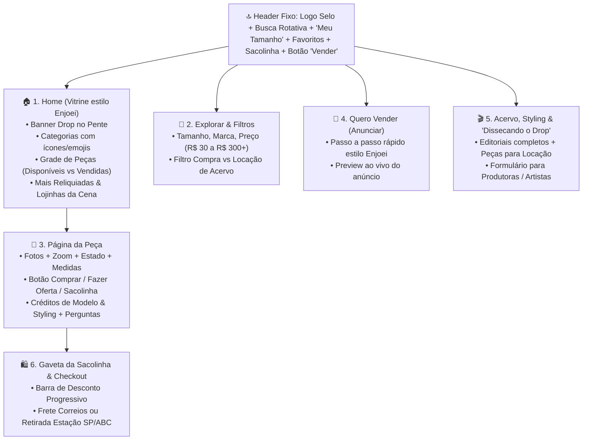

# 🏴 ACERVO DO RELÍQUIA — Documento de Visão, Produto & Arquitetura

> **Origem:** Perfil oficial [`@acervodoreliquia`](https://www.instagram.com/acervodoreliquia/) (*Observatório de Moda • Pesquisa e Produção - Moda de Quebrada • Brechó | Acervo | Styling*)
> **Referência de Plataforma:** [`Enjoei`](https://www.enjoei.com.br/) (*Marketplace dinâmico com busca rápida, propostas de preço, sacolinha e múltiplas lojinhas*)
> **Etapa Atual:** 📝 **1. Planejamento Colaborativo (`.md`)** → *Próxima etapa: Construção do Frontend completo*

---

## 👋 Salve! Como usar este documento
Li o seu perfil autenticado (bio, estética das capas, drops no monotrilho, editoriais como *Dissecando o Drop* e *Quarto de Menina*, faixas de preço e jeito de anunciar) e cruzei tudo com a estrutura do **Enjoei**.

- **Você pode editar este arquivo `.md` diretamente** (marcando `[x]` nas opções e escrevendo nos campos **`✍️ SUAS IDEIAS AQUI`**) **ou me responder direto no chat** com o que quer mudar, tirar ou acrescentar.
- Assim que você validar e colocar suas ideias, eu parto imediatamente para criar o **Frontend**!

---

## 1. O que extraímos do `@acervodoreliquia` (DNA Real da Marca)

1. **Identidade e Território:**
   - Curadoria de `@1renas_tinho` e `@cruela__`, com raiz forte na **Zona Leste de SP (São Mateus, Vila Prudente, Linha 15-Prata do Monotrilho)** e no **ABC Paulista (Mauá, Santo André, São Bernardo)**.
   - Linguagem próxima e autêntica: *"Salve relíquias!"*, *"E aí família"*, *"próximo drop no pente"*, *"dá um pega"*, *"trombar na rápida"*.
2. **A Dor Atual que o Site Resolve na Hora:**
   - Hoje a bio **ainda não tem link de loja**, não há vitrine filtrável de disponíveis e, a cada peça vendida no feed, é preciso editar a legenda manualmente com `❌ VENDIDO ❌` / `❌❌❌ VENDIDO ❌❌❌`.
   - Com o site funcionando estilo **Enjoei**, o link vai direto pra bio: pagou no PIX ou cartão, o sistema dá baixa automática na peça única e já exibe o carimbo de **VENDIDO** sem trabalho manual!
3. **Curadoria de Peças & Faixa de Preço Observada:**
   - **Garimpo de giro rápido e acessível** (ex.: *Nike Dri-Fit Mercurial* por `R$ 38`, *Pólo Ralph Lauren* 🏇🏼 e *Pólo Ecko Silver Collection* 🦏 por `R$ 60`) lado a lado com **peças pesadas de desejo** (*Agasalho Adidas Real Madrid*, jaqueta racing *Alpinestars*, *FUBU*, *Mizuno*, *Y2K / rolezinho*).
   - **Peças históricas de pesquisa/memória** (ex.: camiseta Racionais MCs 1994 e boina *Nada como Um Dia Após o Outro* de 2002) que conectam o brechó ao **Acervo & Styling**.
4. **Rede Colaborativa da Cena (O encaixe perfeito com o modelo Enjoei!):**
   - Vimos que vocês já fazem collabs constantes com outros brechós e coletivos (`@brechodimil`, `@brechodosbari`, `@relicari.oz`, `@gardebrecho_`, `@bonfire_brecho`, `@batalhadamatrix`).
   - Fazer o site funcionar **como o Enjoei** permite que o **Acervo do Relíquia** seja tanto a loja principal quanto **o grande Marketplace da Moda de Quebrada**, onde parceiros e seguidores também podem abrir suas lojinhas e vender!

> **✍️ SUAS IDEIAS AQUI (DNA & Posicionamento):**
> - Concordo com essa leitura, destaco que mais pra frente desejo separar as peças de roupa por marcas, preço e destaques; *Escreva aqui se concorda com essa leitura ou se quer destacar mais algum ponto da história/momento atual do Acervo:*
> - Quero que pense em estratégias de como o site pode ajudar a fortalecer a cena de moda de quebrada, conectando brechós, produtores e estilistas locais.
> - Quero que o site tenha uma seção de blog ou revista, onde possamos contar histórias por trás das peças, drops e editoriais, fortalecendo a narrativa cultural do Acervo do Relíquia.
> - Quero que o nome do site se chame "BRECHOZADAS" e que tenha uma identidade visual forte, com cores e elementos gráficos que remetam à estética urbana e à moda de quebrada.
> - Quero que cada brechó ou loja online que se cadastrar, tenha sua própria pagina dentro do site, com sua identidade visual e catálogo de produtos, como se fosse uma extensão do instagram, mas com mais funcionalidades e controle sobre suas vendas.

---

## 2. Como vai funcionar estilo Enjoei (Módulos do Site)

Marque com `[x]` o que você quer manter já na primeira versão do Frontend:

### 🏪 2.1. Quem pode vender? (Modelo Enjoei)
- [x] **Marketplace Aberto + Curadoria Oficial (Estilo Enjoei):**
  Qualquer usuário pode clicar em **"Quero Vender / Desapegar"**, criar sua lojinha e anunciar peças (você pode cobrar uma taxa `%` por venda concluída, igual ao Enjoei). A loja oficial `@acervodoreliquia` e brechós parceiros ganham o selo **★ Relíquia Verificada**.
- [X ] **Opção "bRECHOZADAS PRO" (Inspirado no Enjoei Pro):**
  - *Modo Direto:* a própria pessoa tira a foto em casa, posta e envia. Porém com desconto de 10% em cada venda do produto (ex.: peça de `R$ 100` → recebe `R$ 90`).
  - *Modo Pro / Consignado:* a pessoa tem impulso de vender, ganhando destaque na pagina e fica isento da taxa de venda (100% do valor vai pra ela). Pense num plano que compense os 10% de taxa do modo direto, mas que seja mais caro que o modo direto (ex.: `R$ 20/mês` ou `R$ 50/trimestre`).
- [ ] **Apenas Loja Própria + Brechós Convidados** *(marque esta se NÃO quiser que usuários comuns anunciem sem convite)*.

### 🔎 2.2. Cabeçalho, Busca & Filtros Inteligentes
- [x] **Barra de Busca Estilo Enjoei** com sugestões rotativas da cena:
  `busque "Pólo Ecko 🦏"...` • `busque "Nike Mercurial"...` • `busque "Agasalho Real Madrid"...` • `busque "Alpinestars"...` • `busque "Y2K / Quarto de Menina"...`
- [x] **Categorias no Topo:**
  `🔥 Novo Drop` • `Polos & Camisas` • `Time & Esporte ⚽` • `Jaquetas & Racing` • `Streetwear 90s/00s` • `Quarto de Menina / Y2K 💋` • `Calças & Bermudas` • `Pisantes` • `🎬 Acervo (Aluguel)`
- [x] **Filtro Rápido "Meu Tamanho":** Botão pra pessoa já travar `P`, `M`, `G`, `GG` ou numeração de tênis/calça e só ver peças únicas que servem nela.

### 💸 2.3. Cards de Produto, "Reliquiar", Oferta e Sacolinha
- [x] **Card de Vitrine Padrão Enjoei:**
  Foto vertical com cantos arredondados, **etiqueta branca flutuante no canto inferior esquerdo com o preço em destaque** (`R$ 60`) e preço antigo riscado quando em promo (`R$ 85`), selo do tamanho (`TAM G`) no topo e segunda foto ao passar o mouse/deslizar.
- [x] **Botão "Reliquiar" (♥ / ★):**
  Equivalente ao *"Yeyezar"* do Enjoei — salva nos favoritos, mostra quantas pessoas estão de olho na peça e alimenta a vitrine **"As Mais Reliquiadas"**.
- [x] **Botão "Fazer Oferta" (Chorar Preço com Respeito):**
  O comprador pode mandar uma proposta (ex.: `-10%`, `-15%` ou valor digitado dentro do limite mínimo definido pelo vendedor), e o vendedor aceita, recusa ou manda contraproposta válida por 24h!
- [x] **Sacolinha Turbinada:**
  Juntou 2 ou 3+ peças da mesma lojinha na sacolinha? Ganha desconto progressivo automático e paga um frete só.
- [x] **Ficha de Ensaio nos Produtos:**
  Espaço opcional na página da peça para creditar quem vestiu e quem clicou (ex.: `Modelo: @ligeirohaniel • Foto & Styling: @1renas_tinho`), mantendo a alma de coletivo/editorial que vocês já fazem nos posts!

### 🚝 2.4. Entrega & Pagamento (Realidade SP/ABC + Brasil)
- [x] **Envio para todo o Brasil** (simulador de CEP Correios / Melhor Envio).
- [x] **Opção "Trombar na Estação / Retirada SP & ABC":**
  Modalidade especial para marcar entrega nas estações (Monotrilho Linha 15-Prata / Linha Verde / Linha Coral CPTM — São Mateus, Vila Prudente, Mauá, Santo André, etc.) sem custo de Correios!
- [x] **Pagamento Seguro com Garantia (Escrow estilo Enjoei):**
  PIX com aprovação instantânea e Cartão — nos anúncios de terceiros, o valor fica protegido até o comprador receber a peça.

### 🎬 2.5. Os Diferenciais Exclusivos do `@acervodoreliquia` (Além do Enjoei!)
- [x] **Modo "Acervo & Styling" (Aluguel para Produções):**
  Peças raras de arquivo aparecem com selo **`ACERVO • LOCAÇÃO`** (em vez de venda) para figurinistas, MCs, diretores de clipe e produtoras montarem uma *Sacolinha de Produção* e solicitarem orçamento de diária + contratação de *Styling*.
- [x] **Revista / Blog "Dissecando o Drop":**
  Espaço integrado para contar a história cultural dos drops e editoriais (como o post do Racionais MCs, *Especial Funk* e *Quarto de Menina*), conectando pesquisa de moda direto com as peças da vitrine!

> **✍️ SUAS IDEIAS AQUI (Funcionalidades):**
> - *O que você quer adicionar, remover ou mudar nessas funções?*
> - Quero também um botão de "Tirar dúvida no WhatsApp / DM" e todas as perguntas e ofertas também dentro do próprio site como no Enjoei
> - Quero que o site tenha uma seção de "Histórias da Quebrada", onde possamos contar histórias de pessoas, lugares e eventos que marcaram a cena de moda urbana, conectando ainda mais com a comunidade.

---

## 3. Direção Visual, Cores & Estética do Frontend

Baseado nas capas e fotos reais do perfil (selo P&B em traço manual/rabiscado, granulado estilo *zine/flyer*, flash direto de *Cybershot*, VHS/*handcam* e estética anos 2000):

### Identidade Gráfica Proposta
- **Base da Vitrine (Área de Compras):** Fundo **Off-White Papel/Concreto (`#F4F2EC`)** com textos e bordas em **Preto Nanquim (`#111111`)** — deixa o site leve e faz as fotos coloridas das roupas saltarem aos olhos (igual ao Enjoei), mas com bordas marcadas estilo zine/etiqueta urbana.
- **Banners, Cabeçalho Editorial & Seção Acervo:** Contraste pesado em **Preto Granulado (`#0D0D0D`)** com textura sutil de filme/halftone e molduras inspiradas em câmera digital anos 2000 / tira de negativo.
- **Opções de Cor de Destaque (Etiquetas de Preço, Ofertas e Botões):**
  Escolha abaixo qual combina mais com vocês (ou sugira outra!):
  - [x] **Opção 1 — Ferrugem / Vermelho Terracota + Amarelo Neon** *(inspirado nas capas gráficas recentes como o Especial Funk + energia de rua)*
  - [ ] **Opção 2 — Verde Flash / Cromo Urbano** *(referência aos rolezinhos, camisas de time e estética anos 2010)*
  - [ ] **Opção 3 — Roxo Digital / Rosa Y2K + Preto** *(ponte visual entre o Enjoei e a estética anos 2000 / Orkut / Quarto de Menina)*
  - [ ] **Opção 4 — Preto, Branco & Prata/Cromo Puro** *(100% fiel ao logo circular do perfil, minimalista e underground)*

> **✍️ SUAS IDEIAS AQUI (Visual, Cores e Clima):**
> - *Qual paleta de cores você mais curte para o site?*
> - *Tem alguma referência visual específica (ex.: estética Cybershot, painel de trem/metrô, colagem de revista anos 2000, ou algo mais limpo)?*
> - Quero algo mais limpo, como um site moderno, mas que ainda mantenha a essência urbana e underground do Acervo do Relíquia. Talvez usar elementos gráficos sutis, como texturas de concreto ou rabiscos, para dar personalidade sem poluir visualmente.

---

## 4. Mapa de Telas do Frontend (O que vou criar na próxima etapa)

---

## 5. Arquitetura Completa Planejada (Evolução do Projeto)

1. **Etapa 1 — Documento `.md` e Alinhamento de Ideias** *(concluído agora — aguardando suas notas!)*
2. **Etapa 2 — Frontend Completo & Interativo** *(próximo passo!)*:
   - Aplicação web moderna em **Next.js + TypeScript + Tailwind CSS**, responsiva para celular (foco total em quem clica pelo Instagram) e computador, já populada com exemplos reais inspirados no `@acervodoreliquia` (Polos Ecko/Ralph Lauren, Nike Mercurial, Agasalhos de time, Y2K, editoriais *Dissecando o Drop* e *Quarto de Menina*, modal funcional de *Fazer Oferta*, *Sacolinha* com cálculo automático de desconto e fluxo de *Quero Vender*).
3. **Etapa 3 — Backend / API & Banco de Dados** *(depois que você aprovar o Frontend)*:
   - API completa, login de usuários/vendedores, banco de dados real para produtos, ofertas, perguntas, pedidos, cálculo real de frete e integração PIX/Cartão.
4. **Etapa 4 — Automação / CLI do Acervo** *(opcional)*:
   - Importador rápido dos posts do Instagram `@acervodoreliquia` para criar anúncios sem redigitar tudo + controle de empréstimo/devolução das peças de *Styling/Acervo*.

---

## ✍️ ESPAÇO LIVRE PARA TODAS AS SUAS IDEIAS

Escreva aqui embaixo (ou me mande direto no chat) qualquer ideia sua, nome de seção, regra do seu brechó ou detalhe que não pode faltar antes de eu criar o Frontend:

- **Minhas ideias extras:**
  1. 
  2. 
  3. 
